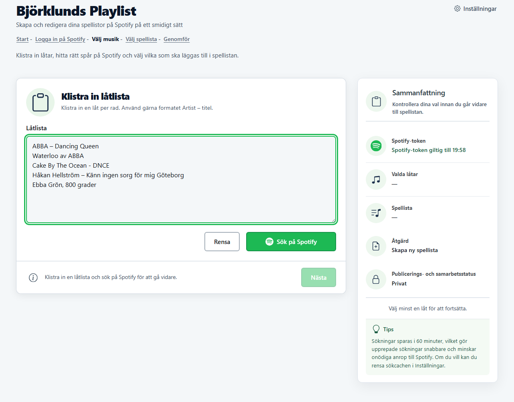
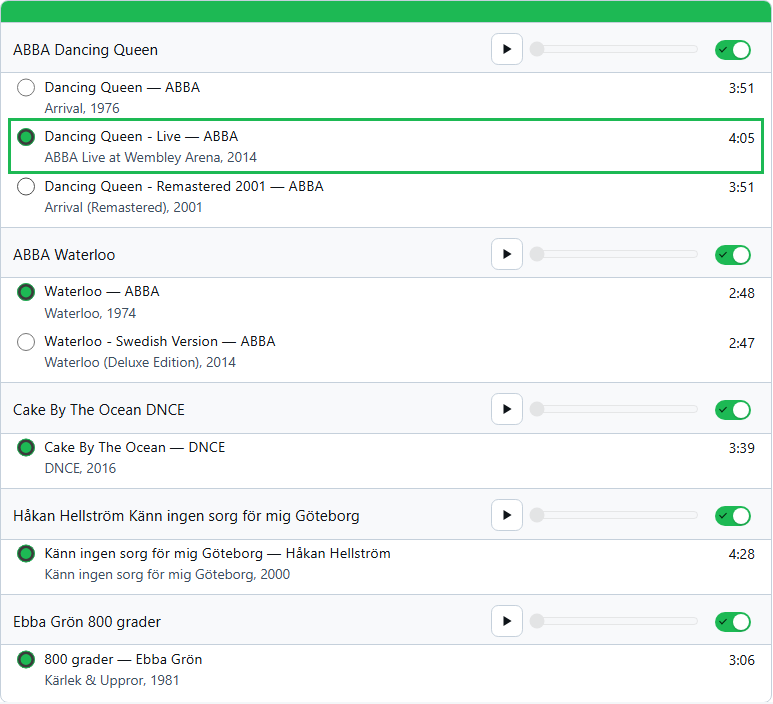
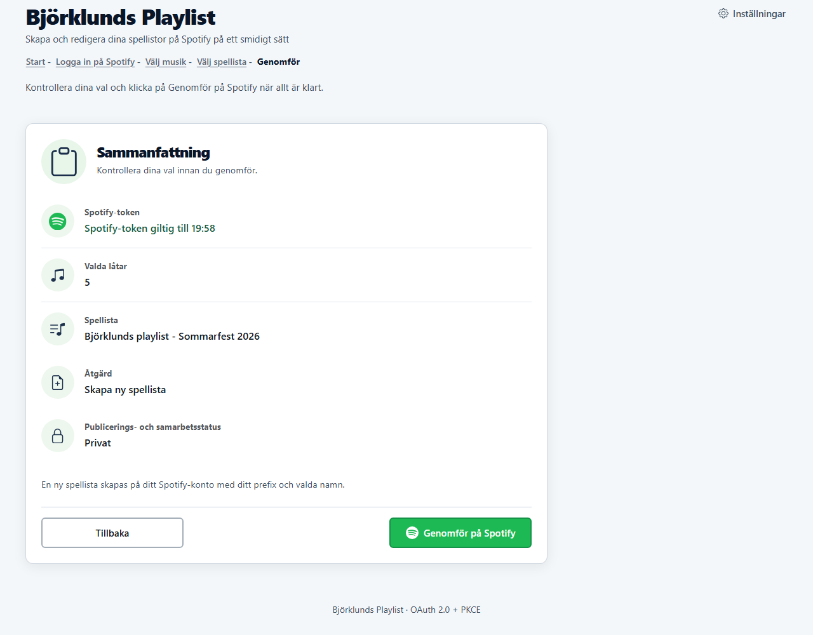
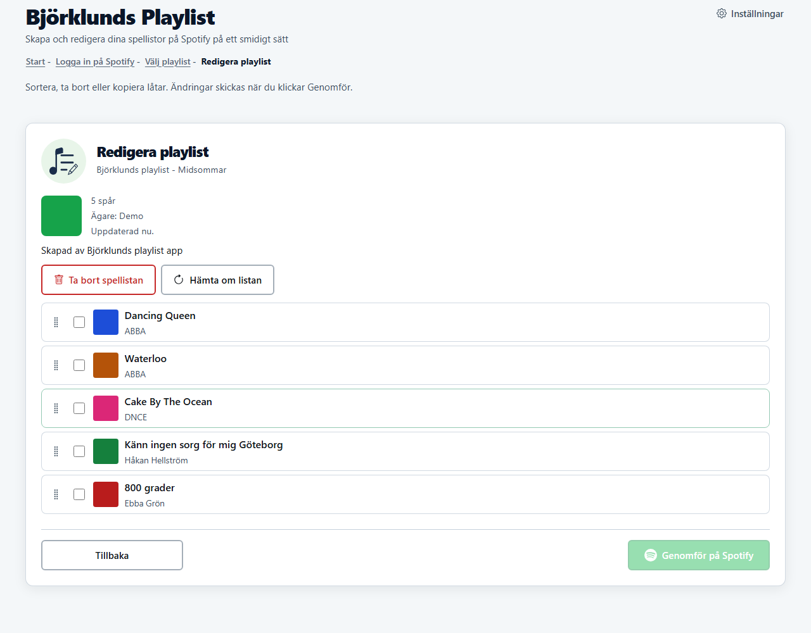

# Björklunds Playlist

[](https://github.com/Stevoxa/bjorklunds-playlist/actions/workflows/ci.yml)
[](LICENSE)

Gör om en textlista med låtar till en Spotify-spellista. Klistra in listan, granska vilka spår appen hittade, välj rätt version där det finns flera och skapa en ny spellista eller uppdatera en befintlig. Appen kan också ordna om och rensa spellistor du redan har.

Allt körs i webbläsaren mot Spotifys Web API. Det finns ingen egen server.

**[Öppna appen →](https://stevoxa.github.io/bjorklunds-playlist/)**

<p align="center">
  
  
</p>
<p align="center">
  
  
</p>

## Vad den löser

En låtlista finns ofta redan som text: i ett mejl, en chatt, ett dokument eller en lista från en fest. Att flytta den till Spotify betyder annars att söka upp varje låt för hand. Här klistrar du in hela listan på en gång, och appen gör sökningarna och låter dig rätta där den är osäker.

## Funktioner

- **Skapa spellista från text.** En rad per låt, i valfritt vanligt format.
- **Granska träffarna.** Varje rad visar upp till fem kandidater. Du väljer version med en radioknapp och slår av rader som inte ska med.
- **Uppdatera befintlig spellista.** Lägg till sist eller ersätt hela innehållet.
- **Redigera spellista.** Dra och släpp för att ändra ordning, markera och ta bort spår, och skicka ändringarna till Spotify i ett svep.
- **Lyssna innan du väljer.** Med Spotify Premium kan du spela upp en träff direkt i raden via Web Playback SDK.
- **Tål Spotifys anropsgränser.** Vid 429 väntar appen enligt `Retry-After` och visar en nedräkning. Skrivningar görs i små steg med paus emellan.
- **Installerbar PWA** med egen ikon och startbild.

## Matchningslogiken

Det här är kärnan i appen och det som skiljer den från att bara klistra in raden i Spotifys sökfält.

### 1. Tolka raden ([`js/parser.js`](js/parser.js))

Tre format känns igen:

| Format | Exempel |
|---|---|
| `Artist – Titel` (bindestreck eller tankstreck) | `ABBA – Dancing Queen` |
| `Titel av Artist` | `Waterloo av ABBA` |
| `Artist, Titel` | `Ebba Grön, 800 grader` |

Rader som inte passar något format söks som fritext.

### 2. Upptäck omkastad ordning

Folk skriver lika ofta `Titel - Artist` som tvärtom. Parsern röstar därför med fyra regler om artist och titel troligen har bytt plats:

- ett typiskt låtsuffix som `(Live)`, `(Remix)` eller `feat.` står i artistdelen
- artistdelen börjar med en siffra men titeldelen gör det inte
- titeldelen är skriven i VERSALER men inte artistdelen (`Cake By The Ocean - DNCE`)
- artistdelen är lång (minst fyra ord) och titeldelen kort, som i YouTube-titlar

Två röster eller fler markerar raden som misstänkt omkastad. En **artistbank** ([`js/artist-bank.js`](js/artist-bank.js)) minns dessutom artistnamn från tidigare träffar, per Spotify-konto. Står ett känt artistnamn i titeldelen räknas raden också som omkastad.

### 3. Sök i en kedja ([`js/spotify-api.js`](js/spotify-api.js))

Varje rad får en kedja av sökningar som avbryts vid första godkända träff:

| Radtyp | Sökningar |
|---|---|
| Fritext (inget känt format) | hela raden som den står |
| Normal | `track:"Titel" artist:"Huvudartist"`, sedan fritext |
| Misstänkt omkastad | omvänd fältsökning, sedan normal fältsökning, sedan fritext |

`feat.`/`ft.` tas bort ur artistfiltret så att huvudartisten styr sökningen.

### 4. Filtrera bort skräp

Träffar som är karaoke, tributversioner eller "in the style of" sorteras bort. Fältsökningar måste också faktiskt matcha raden: titeln ska finnas i spårnamnet och artisten bland spårets artister. Om inget återstår räknas sökningen som en miss och kedjan går vidare.

### 5. Du väljer

Finns flera versioner, till exempel original, live och remaster, visas alla med album, år och längd. Den första är förvald och du byter med ett klick. Sökresultat cachas i 60 minuter så att samma lista inte kostar nya anrop.

## Kom igång

Appen använder ditt eget Spotify Client ID. Det tar ett par minuter att skapa:

1. Logga in på [Spotify Developer Dashboard](https://developer.spotify.com/dashboard) och klicka på **Create app**.
2. Ange **Redirect URI** = adressen där appen körs, med avslutande snedstreck:
   - publicerad version: `https://stevoxa.github.io/bjorklunds-playlist/`
   - lokalt: `http://127.0.0.1:4173/` (Spotify godtar inte `localhost`)
3. Välj **Web API** under *Which API/SDKs are you planning to use?* och spara.
4. Kopiera **Client ID**, klistra in det på inloggningssidan i appen och logga in.

Inställningssidan visar exakt vilken Redirect URI appen förväntar sig, med en kopieringsknapp.

> [!NOTE]
> Nya Spotify-appar körs i *Development mode*. Du som skapat appen kan alltid logga in. Andra konton måste läggas till under **User Management** i dashboarden.

### Behörigheter (scopes)

| Scope | Används till |
|---|---|
| `playlist-read-private`, `playlist-read-collaborative` | Lista och läsa dina spellistor |
| `playlist-modify-public`, `playlist-modify-private` | Skapa, uppdatera, ordna om och rensa spellistor |
| `user-read-private` | Konto-id och marknad, så att sökningar ger spår som går att spela i ditt land |
| `user-read-email` | Visa vem som är inloggad |
| `streaming`, `user-read-playback-state`, `user-modify-playback-state` | Uppspelning per rad (kräver Premium) |

Inloggningen använder OAuth 2.0 Authorization Code med **PKCE**, så det finns ingen klienthemlighet i koden. Token ligger i `sessionStorage` och försvinner när fliken stängs. Den förnyas automatiskt när mindre än tio minuter återstår.

## Utveckling

Kräver Node.js 20 eller senare. `npm install` laddar även ner Chromium för Playwright.

```bash
npm install
npx serve . --listen 4173
```

| Kommando | Vad det gör |
|---|---|
| `npm test` | Röktest: kontrollerar att alla element-id som koden använder finns i `index.html` och att service workerns filer finns |
| `npm run test:flow` | UI-test av steg 2–3: byte mellan ny och befintlig spellista och att sammanfattningen speglar valen |
| `npm run test:e2e` | Alla Playwright-specar, inklusive det mockade Spotify-flödet |
| `npm run verify` | Allt ovan i följd |
| `npm run screenshots:readme` | Tar om skärmbilderna i `docs/screenshots/` |
| `npm run icons:maskable` | Genererar maskable- och Apple touch-ikoner från `icons/icon-674.png` med rätt säkerhetsmarginal |

CI kör röktestet, UI-testet och Playwright-sviten på varje push och pull request, och laddar upp skärmbilderna som artefakt.

### Testa utan Spotify-konto

[`tests/screenshots-flow.spec.js`](tests/screenshots-flow.spec.js) kör hela flödet utan riktigt konto. Inloggningen läggs direkt i `sessionStorage`, och alla anrop till `api.spotify.com` besvaras av `page.route()` med en liten fast katalog. Den innehåller medvetet flera versioner av samma låt och en rad i omvänd ordning, så att skärmbilderna visar hur appen hanterar tvetydiga träffar. Samma spec är alltså både test och källa till README-bilderna.

## Teknik

- **Vanilla JavaScript** med ES-moduler. Inget ramverk och inget byggsteg: det som ligger i repot är det som publiceras.
- **Service worker** ([`sw.js`](sw.js)) som hämtar från nätet först och cachar appens filer, så att den startar snabbt och kan installeras. Sökning och skrivning kräver uppkoppling mot Spotify.
- **IndexedDB** för cachade spellistor (en timme), spellisteinnehåll (15 minuter) och artistbanken. Om Spotify inte svarar visas senast kända data i upp till sju dagar.
- **[SortableJS](https://sortablejs.github.io/Sortable/)** för dra-och-släpp i redigeringsläget, levererad från `vendor/`.
- **GitHub Pages** publicerar `main` direkt.

## Licens

[MIT](LICENSE)
